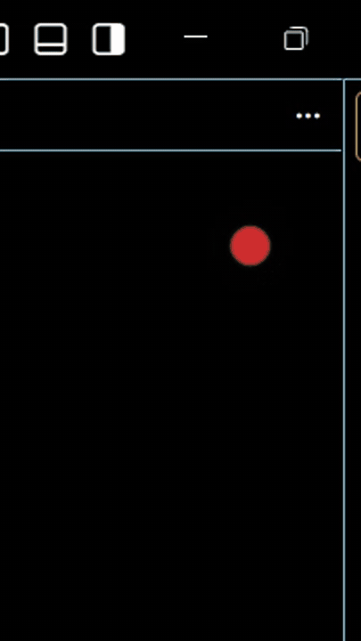

# Task Focuser

Task Focuser is a small floating note for the one to three lines you are focusing on. Lennie the budgie and Meggie the owl keep it company. The Rust app runs on Windows, macOS, and Linux.

<p align="center"></p>

See [migration notes](docs/RUST-MIGRATION.md) for state compatibility, paths, and platform limitations. The demo shows the original Windows app.

## Use the note

Double-click the locked note to edit it. Press `Esc` or `Ctrl+L`, or click the padlock, to lock it again. While editing, use `Ctrl+=` and `Ctrl+-` to change the font size. On macOS, use the Command key in place of Ctrl.

Drag the note to move it. Drop it on the dot at the top of the screen to tuck it away, then double-click the dot to restore it. Drag the dot to the close target to hide both. The tray menu can show the note again or quit the app.

The editing bar controls the note's appearance, bird, and sound. Click the bird's name to choose Lennie or Meggie or rename them. Click the sound control to toggle sound, or hover over it to adjust volume and idle sounds. The bird's quiet idle sounds can keep Bluetooth headphones awake during silent stretches.

## Build and run

Install Rust with [rustup](https://rustup.rs/). The repository selects Rust 1.94.0 through `rust-toolchain.toml`. On Ubuntu, install the native development libraries first:

```sh
sudo apt-get install pkg-config libasound2-dev libudev-dev libwayland-dev libxkbcommon-dev libfontconfig1-dev libx11-dev libxrandr-dev libxi-dev libgl1-mesa-dev
```

Build and run the Rust app with:

```sh
cargo run --locked -p task-focuser
```

For a release build, run `scripts/build.sh` on Linux or macOS, or `scripts/build.ps1` in PowerShell on Windows. The binary is in `target/release/`. Run `scripts/check.sh` to check formatting, lints, and tests. CI checks the workspace on all three platforms and uploads release binaries as workflow artifacts. Its Linux job also exercises the native Wayland window under headless Sway. Windows and macOS jobs compile and run automated tests; they do not exercise the desktop UI.

Use `--help` to list the note commands and options. `--backend auto|native|wayland` selects the desktop host. On Linux, auto selects Wayland when available; that host requires layer-shell support. Use `--backend native` in an X11 session. `--no-tray` and `--no-sound` are available only for isolated runs.

For testing without changing the default note, set `TASKFOCUSER_DATA_DIR` to a disposable directory or set `TASKFOCUSER_PROFILE` to a separate profile name. Isolated runs cannot change login startup settings. See the migration notes for the default state paths.

The original WPF source is available in [Git history](https://github.com/Omni-Wild/task-focuser/tree/67b0db1/app).

## License

MIT. See [LICENSE](LICENSE).
